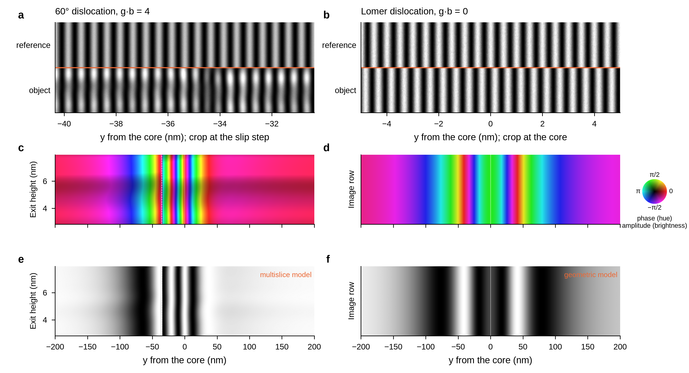

# reflection-holo

**Simulation of reflection-mode (RHEED-geometry) dark-field off-axis electron holography of crystal
surfaces and buried defects.**

A fast electron beam (200 keV) grazes a crystal surface at about 1°, and one Bragg reflection from
the planes parallel to the surface is selected. That reflected wave is then interfered with a
reference wave to record a hologram. The reconstructed phase maps surface steps, and the
near-surface strain of defects buried tens of nanometres below the surface. This repository
simulates the whole chain: atoms → dislocation field → multislice → hologram → reconstructed phase
and amplitude. It also documents the physics, the parameters and the literature, so that future
students can extend it.


*A 60° dislocation 50 nm below Si(001), reflection (008), leaves four net phase fringes (g·b = 4).
A Lomer dislocation (g·b = 0) leaves none. Details: [docs/results/dislocations_50nm.md](docs/results/dislocations_50nm.md).*

## Status

* **Research code (version 0.1).**
* **Validated so far:**
  * the multislice kernel agrees with an independent geometric model, to 0.05 rad on the phase;
  * the step phase matches the refraction formula (Osakabe 1990);
  * the hologram chain is exact on test objects.
* **Not yet validated** against an independent multislice code (abTEM), so absolute amplitudes are
  provisional. See [Limitations](#limitations).

## Install

```bash
git clone https://github.com/alihasuna/Holography.git && cd Holography
python -m venv venv && source venv/bin/activate
pip install -e ".[dev]"        # numpy, scipy, matplotlib, pyyaml, pytest
pip install -e ".[gpu]"        # optional: cupy for NVIDIA GPUs
python -m pytest -q            # 48 tests; the GPU test is skipped without cupy
```

## Quick start

```bash
python examples/01_first_hologram.py                 # whole chain in about 2 s: writes first_hologram.png
python scripts/run_sections.py --config configs/si001_three_sections_cpu.yaml --dry-run           # size a run
python scripts/run_sections.py --config configs/si001_three_sections_cpu.yaml --geometric-only    # fast model, any CPU
python scripts/run_sections.py --config configs/si001_three_sections_cpu.yaml --only "(0,0,8)"    # full multislice, about 7 min on 4 cores
```

Larger cases (0.74 µm cells, 50 nm deep dislocations) take about 2 h per reflection on a 4-core
CPU, or minutes on a GPU. Slurm scripts for Digital Research Alliance of Canada clusters are in
`hpc/`, with instructions in [docs/guide/hpc_alliance.md](docs/guide/hpc_alliance.md).

## The pipeline

| Step | What happens | Code |
|---|---|---|
| 1. Crystal | Si(001) slab in side-by-side strips (reference, raised step, defect) | `reflection_holo/crystal.py`, `structure/sections.py` |
| 2. Defect | analytic elastic field of a buried dislocation (half-space, periodic images, slip step) | `reflection_holo/defects/dislocation.py` |
| 3a. Multislice | grazing sheet beam, about 3000 slices, absorber, objective aperture → dark-field wave | `reflection_holo/forward/multislice.py` |
| 3b. Geometric model | fast column model of the same wave, used as a cross-check | `reflection_holo/forward/geometric.py` |
| 4. Hologram | tilted reference wave, Poisson noise, empty hologram | `reflection_holo/holography.py` |
| 5. Reconstruction | FFT, sideband, inverse FFT, reference correction, unwrapping, ramp removal | `reflection_holo/holography.py` |
| 6. Analysis | profiles, metrics, Nature-style figures | `scripts/run_sections.py`, `scripts/figures_*.py` |

Step-by-step explanation: [docs/guide/pipeline.md](docs/guide/pipeline.md).

## Repository map

```
reflection_holo/   the library: geometry, crystal, defects, forward models, holography, provenance
configs/           sample definitions (YAML); every value carries an evidence label
examples/          short, commented tutorials
scripts/           run, sweep and figure scripts
hpc/               Slurm job scripts for Alliance clusters (Fir, Narval, ...)
tests/             pytest suite (physics checks, round trips, CPU/GPU agreement)
tools/             standalone step-phase calculator and software-provenance checks
docs/
  guide/           pipeline, parameters, running on GPUs and clusters, inputs needed from experiment
  theory/          physics summary, conventions, model assumptions, buried defects
  results/         three-strip sample, 60° and Lomer dislocations at 50 nm
  literature/      literature position, surveys (reflection holography, dark-field strain), references.bib
  figures/         all figures (PDF + PNG) with captions in CAPTIONS.md
  dev/             project history: original audit, specification, agent reports
```

## Documentation: where to start

| If you want to... | Read |
|---|---|
| understand the method in one go | [docs/guide/pipeline.md](docs/guide/pipeline.md) |
| know what every parameter means | [docs/guide/parameters.md](docs/guide/parameters.md) |
| understand the physics (refraction, step phase, wrap period, dynamical effects) | [docs/theory/physics_summary.md](docs/theory/physics_summary.md) |
| learn why buried dislocations are visible in reflection | [docs/theory/buried_defects.md](docs/theory/buried_defects.md) |
| see the results | [docs/results/three_strips_results.md](docs/results/three_strips_results.md), [docs/results/dislocations_50nm.md](docs/results/dislocations_50nm.md) |
| run on a GPU or a cluster | [docs/guide/gpu_arbutus.md](docs/guide/gpu_arbutus.md), [docs/guide/hpc_alliance.md](docs/guide/hpc_alliance.md) |
| connect the simulation to a real experiment | [docs/guide/experiment_inputs.md](docs/guide/experiment_inputs.md) |
| place the work in the literature | [docs/literature/reflection_holography.md](docs/literature/reflection_holography.md), [docs/literature/dark_field_strain.md](docs/literature/dark_field_strain.md) |

## Conventions

* **Units:** Å, mrad, rad and keV.
* **Slab frame:** x is the outward surface normal, y is across the beam, z is along the beam.
* **Phase convention:** see [docs/theory/physics_conventions.md](docs/theory/physics_conventions.md).
* **Evidence labels:** every parameter and claim carries one, so it is always clear what was given,
  assumed, derived, read in a source, or only smoke-tested. Labels include PROJECT_INPUT,
  ASSUMPTION, DERIVED_HERE, SECTION_READ and SMOKE_TEST
  ([docs/theory/model_assumptions.md](docs/theory/model_assumptions.md)).

## Limitations

* **No independent validation yet:** the multislice kernel has not been checked against abTEM or a
  dynamical reflection solver (milestone M2 in `docs/dev/05_final_repository_specification.md`).
* **Placeholder absorption:** the absorption value is not sourced, and it sets the size of the
  amplitude contrast.
* **Simplified elasticity and surface:**
  * the elasticity is isotropic (silicon's Zener ratio is 1.56);
  * the surface is unreconstructed (no 2×1 dimers) and has no oxide;
  * dislocations are perfect, not dissociated.
* **Missing experimental inputs:** objective aperture, beam azimuth, absorption and the others
  listed in [docs/guide/experiment_inputs.md](docs/guide/experiment_inputs.md).

## Citing

See [CITATION.cff](CITATION.cff) (GitHub shows a "Cite this repository" button). Released under
the [MIT licence](LICENSE).
